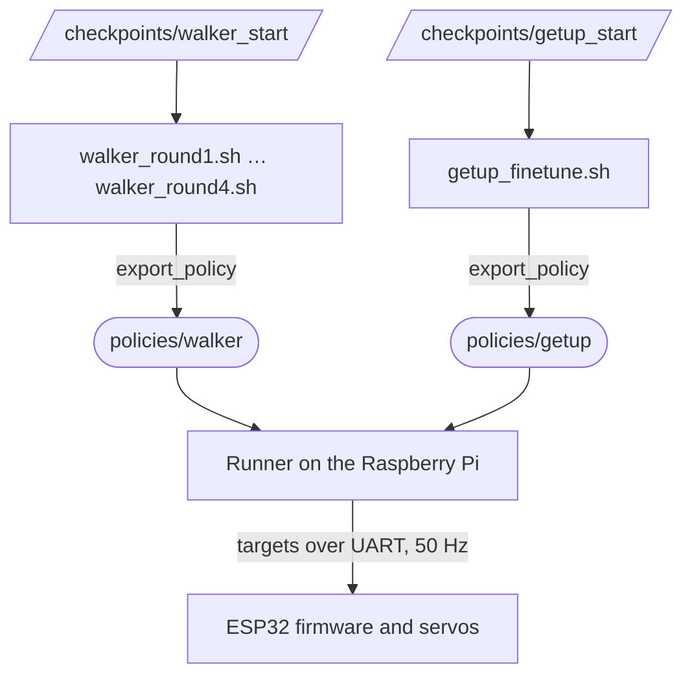

# mini_pupper_4_recovery

Walking and fall recovery for the Mini Pupper v4 (SKU2), the long body with a Raspberry Pi 5 and the 3S LiPo inside. Two
policies run on the Pi at 50 Hz and send servo targets over UART to the ESP32 board: a walker that walks in every direction,
turns in place and rides out shoves, and a get-up that puts the robot back on its feet from any fall pose. This repository
has the policies, the program that runs them on the robot, the evaluation in simulation and the recipes that fine-tuned them.

## Policies

| Policy | What it does | Inputs | How it was made |
|---|---|---|---|
| `policies/walker` | Walks in every direction and turns in place, rides out shoves; in simulation also on rough ground and the printed stairs | 450 (10 frames × 45) | Fine-tuned in four rounds from `checkpoints/walker_start` (`scripts/recipes/walker_round1.sh` to `walker_round4.sh`) |
| `policies/getup` | Gets up from any fall pose, with or without the lidar on the hood | 45 | Fine-tuned from `checkpoints/getup_start` (`scripts/recipes/getup_finetune.sh`) |

Both were trained on the robot's simulated plant: the SKU2 model, the MD-300 servo model and the weighed masses (630.5 g).
The two networks run separately: the runner on the Pi switches to the get-up on a detected fall and back to the walker once the
robot stands.

## How the pieces fit



## On the robot

The robot needs the [servo-link firmware](docs/ROBOT.md#firmware) with its get-up mode. [docs/ROBOT.md](docs/ROBOT.md) covers
the firmware, the checks before a run, launching, stopping, the safety rules and what was measured.

## Quick start

```bash
git clone <this repository> && cd mini_pupper_4_recovery
bash scripts/install/install.sh                       # see docs/INSTALL.md
# Evaluation and training need an NVIDIA GPU; without one the installer picks CPU mode.
.venv/bin/python -m pytest tests/cpu                  # no GPU needed

# Evaluate in simulation: the get-up from every start, and walk, shove, fall, get up, walk for 60 s; then the tables
sh scripts/eval/sku2.sh runs/eval gflat_s21 seq_s21
python3 scripts/eval/score.py runs/eval

# Fine-tune the get-up from its starting checkpoint and export the result (the walker: docs/TRAINING.md)
sh scripts/recipes/getup_finetune.sh
.venv/bin/python -m mp4_recovery.export_policy runs/getup_finetune/<run>/model_<k>.pt runs/exports/getup

# Put the policies on the Raspberry Pi and run them: see docs/ROBOT.md
tools/deploy.sh ubuntu@PI walk   # walk: the folder on the Pi
```

## Results

**Simulation.** `sh scripts/eval/sku2.sh runs/eval` runs every evaluation (about 4 h on one GPU) and `python3
scripts/eval/score.py runs/eval` prints the result tables: the walker's speed on each command against the classic gait
(the firmware's trot on the same plant), falls under kicks standing and walking, rough ground and the printed stairs;
get-up success and time from each start, flat and with the lidar, on rough ground and on the stairs; and the full
sequence of walking, kicks, falls and get-ups. The plant: the MD-300 servo model on a 3S supply (10.5-12.6 V), the
weighed masses; the lidar is a 35 mm high, 19 mm radius cylinder of 43.2 g on the hood.

**One robot, by hand**, with `policies/walker` and `policies/getup`:

| | Result |
|---|---|
| Get-ups from placed fall poses: back, left side, right side, nose down | 4 of 4, and 2 of 2 with the lidar; standing in 1.5-1.7 s |
| Shoves by hand, standing and walking | every fall recovered: up again in 1.4-1.7 s and walking on |
| Walking forward, backward and sideways at 0.10-0.20 m/s | 0.69-0.91 × the speed simulation predicts for the same command (sideways the slowest), no falls |
| Turning in place at ±0.5 to ±2.0 rad/s | up to 1.71 rad/s and -1.83 rad/s at a ±2.0 rad/s command |
| Walking at 0.10 m/s while turning at 0.5 rad/s | about two thirds of the simulated turn (0.67 ×) |

## What isn't supported yet

- The printed stairs and rough ground are tested in simulation only, not on the robot.
- The shipped contract and joint limits belong to one robot: another unit needs its own calibration
  ([ROBOT.md](docs/ROBOT.md#adapting-to-another-unit)).

## What is where

```
policies/          the shipped policies
checkpoints/       each policy's starting checkpoint and final one
data/              stair layouts
scripts/           installer, fine-tuning recipes, evaluation (sku2.sh, score.py)
src/mp4_recovery/
  gpu/             training: get-up and walker tasks, PPO anchored to a parent, the smoothness loss, terrain
  eval/            get-up, full sequence, shoves, walking in every direction, terrain
  deploy/          the runner and the serial link; numpy and pyserial only
  export_policy.py checkpoint to policy
  robot/, actuators/  the robot model and the fitted servo model
tools/             deploy, stop, lifted playback, contract and joint limits for another unit, run summaries, robot-versus-simulation
tests/             cpu/ needs no GPU, gpu/ 5-15 min
docs/              INSTALL, TRAINING, ROBOT, POLICY_CONTRACT
```
