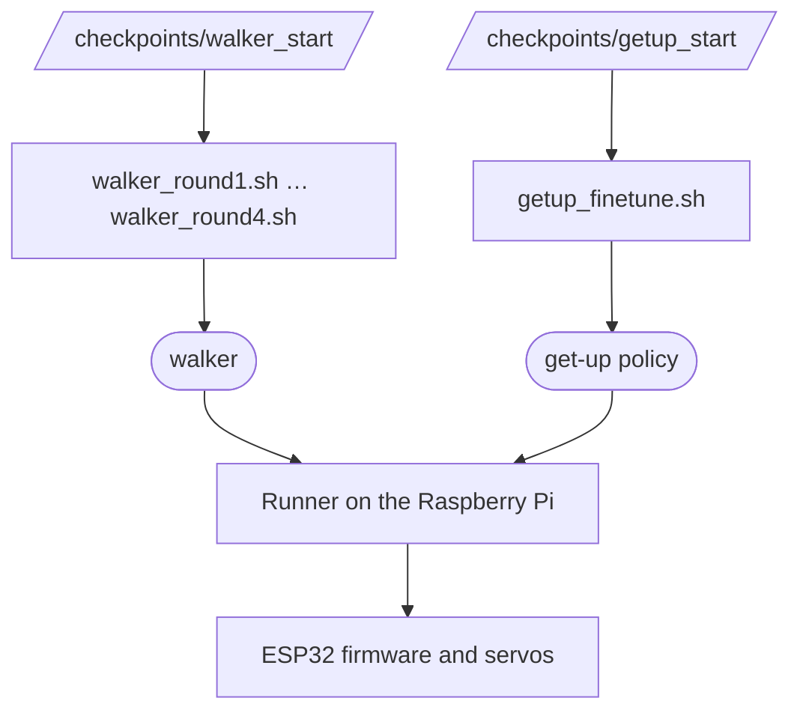
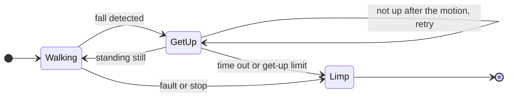

# mini_pupper_4_recovery

Fall recovery for the Mini Pupper v4 (SKU2): rides out shoves, gets up from the falls tested so far, and walks on. This repository has
the get-up training recipe, the evaluation, the program that runs on the robot, and the trained policies.

<p align="center">
  
</p>
<p align="center">
  
</p>

## Policies

| Policy | What it does | Inputs | How it was made |
|---|---|---|---|
| `policies/walker` | Stands, walks in every direction, climbs stairs, rides out shoves | 450 (10 frames × 45) | Fine-tuned in four steps from `checkpoints/walker_start` (`scripts/recipes/walker_round1.sh` to `walker_round4.sh`) |
| `policies/getup` | Gets up from the fall poses tested so far | 45 | Fine-tuned from `checkpoints/getup_start` (`scripts/recipes/getup_finetune.sh`) |

The two networks run separately. A program on the Raspberry Pi switches to the get-up on a detected fall and back to
the walker once the robot stands.

## How the pieces fit



## On the robot



The robot needs the [servo-link firmware](docs/ROBOT.md#firmware) with its get-up mode.

## Quick start

```bash
git clone <this repository> && cd mini_pupper_4_recovery
bash scripts/install/install.sh                       # 15-45 min, about 6.5 GB; see docs/INSTALL.md
# Evaluation and training need an NVIDIA GPU; without one the installer picks CPU mode.
.venv/bin/python -m pytest tests/cpu                  # about 5 min, no GPU needed

# Evaluate a get-up from every start (about 5 min)
.venv/bin/python -m mp4_recovery.eval.getup_eval --policy policies/getup --seed 12 --robots 256 --seconds 8 \
  --starts left,right,nose,back,midfall,crouch,random --motion --json runs/eval/getup.json

# The full sequence: walk, shove, fall, get up, walk, for 60 s (about 6 min)
.venv/bin/python -m mp4_recovery.eval.sequence --walker policies/walker --getup policies/getup \
  --schedule 0.5 1.5 2 4 --robots 256 --seconds 60 --seed 12 --getup-phase-restart 1.0 --json runs/eval/sequence.json

# Fine-tune the get-up from its starting checkpoint
sh scripts/recipes/getup_finetune.sh

# Put the policies on a Raspberry Pi and run them: see docs/ROBOT.md
tools/deploy.sh user@pi walk   # walk: the folder on the Pi
```

The result of a training run depends on its random seed. Compare runs with the sequence evaluation: it separates them
better than success from a placed pose.

## Results

`sh scripts/eval/sku2.sh runs/eval` evaluates both policies in simulation (about 4 h on one GPU) and
`python scripts/eval/score.py runs/eval` prints the tables.

## What is where

```
policies/          the shipped policies
checkpoints/       the fine-tuning recipes' starting checkpoints and each policy's final one
data/              stair layouts
scripts/           installer, fine-tuning recipes, evaluation
src/mp4_recovery/
  gpu/             training: get-up task, PPO with the smoothness loss, cloning, motion search
  eval/            get-up, full sequence, thresholds, shoves, walking, terrain
  deploy/          the runner and the serial link; numpy and pyserial only
  export_policy.py checkpoint to policy
  robot/, actuators/  the robot model and the fitted servo model
tools/             deploy, stop, stream playback, contract for another unit, run summaries, robot-versus-simulation
tests/             cpu/ needs no GPU, gpu/ 5-15 min
docs/              INSTALL, TRAINING, ROBOT, POLICY_CONTRACT
```
