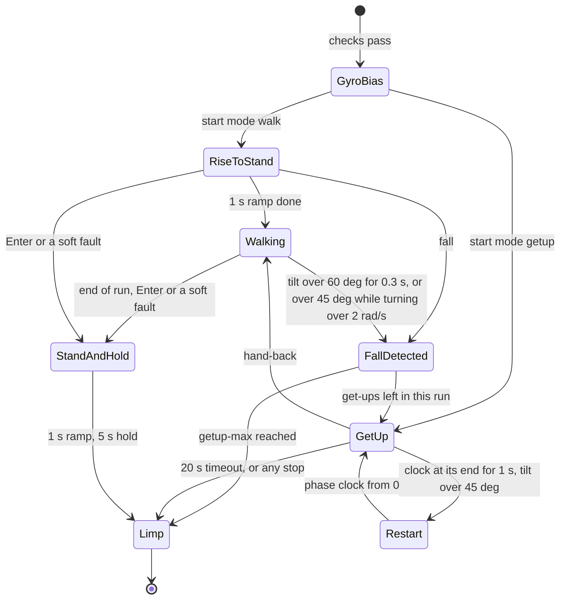

# The walker and the get-up on the Mini Pupper v4 (SKU2)

Two policies run together on a Mini Pupper v4 (SKU2): the long body with a Raspberry Pi 5, the 3S LiPo inside. The Pi runs
the policies at 50 Hz and sends servo targets over UART to the ESP32 board. The **walker** (`mp4_rl/skills/walker/policies/sku2`) stands, walks
and rides out shoves. The **get-up** (`mp4_rl/skills/getup/policies/sku2`) takes over when the runner detects a fall, and hands back once the
robot stands: the walk, shove, fall, get-up, walk sequence.

The shipped calibration and joint limits are those of the unit the policies were trained for and measured on. On any
other unit, go through [Adapting to another unit](#adapting-to-another-unit) first.

## Requirements

- Mini Pupper v4 (SKU2) with the hood on and the battery inside (the simulated body includes both). The lidar on the hood
  (LDROBOT STL-06P, about 38 mm across, 35 mm high, 43.2 g) is optional: the get-up was trained with and without a load there.
- The Mini Pupper v4 firmware on the ESP32 board: see [Firmware](#firmware).
- Raspberry Pi 5 with Python 3.10 or newer, numpy and pyserial (`sudo apt install python3-numpy python3-serial`). Nothing else
  is installed on the Pi: `tools/deploy.sh` copies the runner's files, so the package's own Python 3.12 requirement (for
  training on the workstation) doesn't apply there.
- The Pi's UART: `dtparam=uart0=on` in `/boot/firmware/config.txt`, no serial console on `ttyAMA0`, your user in `dialout`.
- On the workstation: `ssh` and `rsync`.
- A hand ready on the stop, and a foam mat for floor falls.

## Firmware

The policies run with the [Mini Pupper v4 firmware](https://github.com/mangdangroboticsclub/minipupper_4_mcu) on the
ESP32-S3: the Pi sends it the servo targets over UART, in walking and in get-up mode. Build and flash it as its README
describes. Flashing keeps the calibration offsets.

**Never flash a factory-profile build** (`sdkconfig.defaults.factory`): it writes an identity into the ESP32's eFuses at
first boot, which can't be undone. The runner goes limp when the firmware doesn't echo the get-up mode.

What the firmware does on its own:

| Guard | Limit | Result |
|---|---|---|
| Link watchdog | no frame for 100 ms | every servo idle |
| Current, walking | any driven servo above 1500 mA for 500 ms | every servo idle, latched |
| Current, get-up mode | **none** | see [No current guard in get-up mode](#no-current-guard-in-get-up-mode) |
| Temperature, at arming | any servo at 45 °C or above | the ARM is refused (STATE flag HOT, the hottest servo named) |
| Temperature, both modes | a driven servo at 55 °C or above for 1 s | every servo limp at once, latched |
| Servo board | silent for 100 ms | every servo idle, latched |
| Tick | stalled for 500 ms | the ESP32 reboots, every servo idle |

Each servo's temperature is the median of its last three readings, so one glitched frame never counts; a servo with no valid
reading for 250 ms isn't counted until it has three again. On a temperature trip there is no ramp to the stand: the robot drops.
The runner and `mp4link` stop when the firmware refuses their ARM or disarms on a temperature. Calibration offsets are stored on the ESP32, up to ±120°.

## Deploying

From the workstation, at the repository root:

```sh
tools/deploy.sh ubuntu@PI walk
```

`ubuntu@PI` is the Pi's user and address (for example `ubuntu@raspberrypi.local`), and `walk` the folder in its home directory.
This copies the runner, the two policy folders (each with the calibration and joint limits it was exported for), three
files from the installed `mp4_sim` (`__init__.py`, `calibration.py` and the IMU mounting, `imu_mount.json`), and any
`runs/streams/` into `~/walk` on the Pi, and runs `runner check` on each policy
there; a failed check prints `FAIL` and stops the script. Redeploy after changing a calibration or a policy. The runner reads
the calibration from each policy folder and refuses a walker and a get-up exported for different calibrations.

## Start-up checks

After every power-up, battery swap or Pi reboot.

**Power order:** the ESP32 board first, then the Pi. If the Pi has its own supply, don't cycle the board alone with the Pi on.
If `ping` says `IMU ABSENT`: Pi off (`sudo poweroff`, then unplug), board off, USB unplugged, 10 s, board on, then Pi.

```sh
ssh -t ubuntu@PI                    # -t: Enter, the graceful stop, needs a terminal
cd ~/walk
M="env PYTHONPATH=src python3 -B -m mp4_rl.deploy.mp4link"
R="env PYTHONPATH=src python3 -B -m mp4_rl.deploy.runner"
fuser /dev/ttyAMA0                  # must print nothing: nothing else holds the link
$M ping --seconds 2                 # STATE at about 200 Hz, 0 CRC errors, IMU ok, fresh feedback from all four legs
vcgencmd get_throttled              # 0x0 is good; 0x50005 is under-voltage right now
```

No STATE means other firmware: stop.

**The calibration**, at the start of each day and whenever someone else has used the robot:

```sh
$M offsets --json /tmp/offsets.json
python3 -c "
import json
a = json.load(open('/tmp/offsets.json'))['offsets_deg']
c = json.load(open('mp4_rl/skills/walker/policies/sku2/sku2_contract.json'))['offsets_deg']
print('offsets ok' if a == c else 'MISMATCH')"
$M config                           # the servo gains, which every power-off of the servos loses; calib needs them
$M calib --seconds 20               # holds the stand 20 s at 300 mA, saves nothing: look for left/right symmetry
```

A mismatch or a wrong-looking stand means someone recalibrated or re-horned a joint: sort that out first. The runner only warns
about a small mismatch at start-up, so this look at the stand matters.

## Lifted playback

Do this before the first floor run on a robot, and with any policy you haven't run before. Put the robot on a block, or hold
it, with every leg free. The motions come from the simulated get-up, about a minute per start on the workstation's CPU. This
needs the `gpu` install's packages; on a Linux machine without an NVIDIA GPU, install them with
`bash scripts/install/install.sh --mode gpu --skip-verify` (the check would fail without CUDA):

```sh
.venv/bin/python tools/getup_stream.py --policy mp4_rl/skills/getup/policies/sku2         # back, left, right, nose at 25 % and full speed, in runs/streams/
tools/deploy.sh ubuntu@PI walk                               # copies runs/streams/ too
```

Then on the Pi, after the start-up checks, one file at a time, each start at 25 % before full speed (`s14` in the names is
`getup_stream.py`'s default seed):

```sh
$M config                           # the servo gains
$M stream runs/streams/getup_back_s14_x0p25.npz --cap 600 --log logs/lifted_back_x0p25
$M stream runs/streams/getup_back_s14_x1p00.npz --cap 2000 --log logs/lifted_back_x1p00
```

`--cap` is the current cap sent in each frame, in mA. In the servos' control mode it acts only as a duty limit, 0.001 × the
cap: 600 (duty 0.6) is plenty at 25 %, and 2000 gives the full duty (0.99) the runner's get-up uses.

Each one ramps from where the legs are to the first pose in 2 s, holds 1 s, plays, ramps back to the stand in 1 s, holds 1 s
and goes limp. It runs in the firmware's get-up mode, so **there's no current guard**. It starts only below 45 °C, refuses a
file with a target near a track end, and stops and returns to the stand if a joint reads within 15° of one, a housing holds
55 °C for 1 s (`--stop-c`), or the firmware doesn't echo the get-up mode.

Watch for a leg hitting the body or another leg, a joint moving the wrong way or lagging far behind the others, and any grinding
or clicking from an abduction. **Enter** stops and returns to the stand; Ctrl-C goes limp at once. Stop for good if you see any
of these, and sort out the cause before a floor run.

The summary should say `stream completed`, with 0 targets clipped (a frame or two from tick rounding is fine) and the get-up
mode echoed on 100 % of frames. Check the abductions by hand, and the temperature between files
(`$M ping --seconds 1 | grep "max temp"`). Then start floor get-ups with `--getup-max 1`.

## Launching

```sh
# Get up from a pose you placed it in, then stand briefly
$R run --start-mode getup --getup-max 1 --seconds 8 --log logs/up1

# Stand in place and take shoves
$R run --seconds 40 --log logs/shove1

# Walk and take shoves: at 0.10 m/s, 15 s is about 1.5 m
$R run --vx 0.10 --seconds 15 --log logs/walk1
```

Sideways is `--vy 0.10`, turning is `--wz 0.5`. Use a new log name each time. Keep runs short.

**Hands off, and the robot still, for the first second of every run:** the runner measures the gyro's bias then, and refuses
the run if the robot moved.

- **Sequence:** 1 s of gyro calibration, 1 s rising to the stand, then the walker. With `--start-mode getup` there's no rise:
  the get-up starts straight away.
- **Where the walker heads:** it holds the direction it faced at launch. Aim it first. If you turn it by hand, it steers back.
  `--no-heading-loop` turns this off.
- **`--seconds`** is the policy loop's length, get-ups included. At its end the robot ramps to the stand, holds 5 s and goes
  limp (the body drops about 7 cm). If the time runs out during a get-up, it goes limp at once, mid-flip if that's where it
  is, so leave a margin after the last shove.
- **`--getup-max`** (default 10): get-ups allowed in one run; the next fall goes limp.
- **`--getup-timeout`** (default 20 s): not up after this long in one get-up, limp.
- **`--getup-phase-restart`** (default 1 s): the retry. The get-up's phase clock runs for 4 s; if the robot is still tilted
  more than 45° this long after the clock's end, the attempt starts again, 5 s after it began. Leave it on: at 0, a missed
  first attempt never tries again.

The logs go to `<log>.npz` (every frame), `<log>.policy.npz` (every policy step and get-up) and `<log>.stand.json`. They're
written only at the end of a run, so run `sync` on the Pi after one you care about. Copied to the workstation, a folder of them
is summarised by `.venv/bin/python tools/summarise_runs.py logs`.

### What the runner does



- **Hand-back:** tilt under 12°, gyro under 0.8 rad/s and the pose within 10° rms of the stand, all held for 25 steps (0.5 s).
- **Soft faults:** an invalid IMU frame, a non-finite action, a gap in the STATE frames, two late steps in a row.
- **Limp at once, from any state:** Ctrl-C, a link fault or firmware guard, a target that fails its check, no get-up echo from
  the firmware for 0.2 s.

### Refusals before arming

- A latched fault (add `--clear` once you know why it tripped), a servo gain that doesn't read back, no valid IMU.
- A joint reading within 10° of a potentiometer track end (`implausible positions`): move that leg by hand and launch again.
- A policy trained for another robot: its servo model, leg set, foot or robot model file (by its hash) differ from this
  robot's.
- A policy folder without its calibration (`sku2_contract.json`), a calibration the policy was not exported for, or a
  walker and a get-up that carry different calibrations.
- A policy whose bounds were made for another calibration.
- A gyro bias over 0.02 rad/s on any axis in the first second: the robot moved. Keep it still and launch again.
- In the firmware: an ARM while a servo is at 45 °C or above. The runner stops at once with `servo N at X degC: the firmware
  refused to arm`; let that servo cool and launch again.

## Placing it

For `--start-mode getup`:

| Pose | How | Standing after |
|---|---|---|
| On its back | Belly up, legs up; it flips over | 1.6 s, 1.7 s with the lidar |
| Left side down | On its left flank; it rolls straight onto its legs | 1.5 s |
| Right side down | On its right flank; it rolls straight onto its legs | 1.5 s, 1.6 s with the lidar |
| Nose down | Leaning on its front legs, nose lowest; not stable, so let it settle first | 1.5 s |

## During and between runs

- **Shoves:** push the body with the flat of your hand or a stick, not the legs, then let it settle. Keep your hand clear of the
  legs once it's going over: the get-up starts within about 0.3 s.
- **Stop before you pick it up.** While a run is on, lifting it counts as a fall: the legs start a get-up in your hands, and it
  uses one of the run's get-ups (with `--getup-max 1`, it goes limp).
- **Abductions:** feel them by hand for new play or roughness after back flips and after each set of shoves.
- **The Pi's cable:** route it with slack along how the robot moves, with strain relief. A snag can stop a flip, and a tug can
  cut the Pi's power.
- **The IMU is on the ESP32 board:** keep the board in its original mounting. The Pi can sit elsewhere, rigidly fixed, inside
  the body's footprint.

### Temperatures

```sh
$M ping --seconds 1 | grep "max temp"
```

The firmware holds the temperature rules: it refuses to arm with a servo at 45 °C or above, and goes limp at once when a driven
servo stays at 55 °C or above for 1 s. The runner, `stream`, `centre` and `calib` stop on either, naming the servo and its
temperature (`the firmware refused to arm`, `the firmware disarmed at 55 degC`). The front-right abduction and hip run warmest: 42-45 °C after a long standing run, so
the next arm can be refused. Off load they cool about 3 °C in a few minutes. A raw reading can spike for one frame: check
again before worrying.

## Stopping

- **Enter** (in the `ssh -t` terminal): standing or walking, it ramps to the stand, holds, then goes limp. In a get-up, limp at
  once.
- **Ctrl-C**, or `tools/stop.sh ubuntu@PI` from any terminal on the workstation: limp at once, the body drops, the log is saved.
- **The servo power switch** cuts everything.

The firmware's walking current guard and temperature cut-out latch: the next launch is refused until you add `--clear`. Look
at why first.

## No current guard in get-up mode

**Nothing limits or stops the current during a get-up.** The firmware's current guard is off in that mode, because a get-up holds
joints near stall and the walking guard would trip. The frame's 2 A cap doesn't help: in the servos' control mode it only limits
duty, to `min(0.99, 0.001 × 2000)`, so 0.99. The runner prints an advisory above 1.2 A for over 1 s, logs it and carries on.

So a jammed joint or a snagged leg is driven at full duty until the robot stands, the 20 s timeout ends the get-up, the
temperature cut-out trips or you stop it.

**The abduction gears are what this puts at risk.** The servo module's abduction gear train is the robot's weak part: on two bench
units it failed with a wedging tooth, from the dynamic torque of arresting a heavy load at high gain, and a static torque cap
didn't protect it. A back flip's landing loads it, and nothing measures that on the robot. Expect wear, and possibly a break:

- check the abductions by hand after back flips and shoves, and stop if one feels rough or has new play;
- keep a spare servo module on the bench;
- don't let it retry for long. The housing temperature lags: about 5 °C at the housing has been measured against about 40 °C at
  the winding, so repeated attempts heat the motors far more than the temperature rules see;
- the default budget (`--getup-max 10`, `--getup-timeout 20`) can mean long periods of near-stall drive with no current guard. Use
  `--getup-max 1` while testing a new policy, and check the temperature between runs.

**Never command joints near the potentiometer track ends.** Beyond each end lies a dead zone where the position can't be read.
The policies' bounds keep every target at least 20° inside on the hips and knees, and the runner refuses a target within 15° of
an end; keep your own motions and tools inside the same margins.

## What was measured

With `mp4_rl/skills/walker/policies/sku2` and `mp4_rl/skills/getup/policies/sku2`; each take is one run of the runner. Get-up times
come from the runner's log, speeds from the distance on a tape measure over the run's time, turn rates from the gyro.

- **Get-ups:** one take from each placed fall pose (back, left, right, nose down) and two more with the lidar (back,
  right): every one up, standing in 1.5-1.7 s.
- **Shoves:** two runs, standing (40 s) and walking at 0.10 m/s (15 s), six shoves by hand: every get-up the run's time
  allowed (five) up again in 1.4-1.7 s, walking on in the walking run.
- **Walking:** seven takes, forward at 0.10 (two) and 0.20 m/s, backward at 0.10 m/s, sideways at 0.10 (two) and
  0.20 m/s: 0.69-0.91 × the speed simulation predicts for the same command, sideways the slowest. No falls.
- **Turning in place:** five takes at ±0.5, +1.0 and ±2.0 rad/s: 0.81-0.90 × the simulation, up to 1.71 rad/s and
  -1.83 rad/s at a ±2.0 rad/s command.
- **Walking while turning:** one take at 0.10 m/s and 0.5 rad/s keeps only about two thirds of the simulated turn (0.67 ×).
- **The printed stairs and rough ground** were evaluated in simulation ([the walker](../../walker/README.md)).

## Known limitations

- **After a get-up the heading hold may keep a small turn** (0.1-0.2 rad/s) for a moment, steering back towards the heading
  before the fall.
- **Lifting the robot by hand during a run counts as a fall** and uses a get-up. Stop the run first.
- **A retry** starts 5 s after the start of a failed attempt (the 4 s phase clock plus `--getup-phase-restart`'s 1 s),
  whenever the attempt failed. It's a runner rule, not a learned behaviour.
- **If it goes limp at the walker's first step** with `watchdog` in the message, nothing is wrong with the robot: stand it up and
  launch again. `tools/first_step_timing.py --starts 10` measures that first step on the Pi, without motors.

## Comparing a run with the simulation

`tools/compare_run.py` puts a robot log next to simulated robots on the workstation: `stream LOG.npz --stream FILE.npz --policy
DIR` for a lifted playback, `floor LOG_PREFIX --policy DIR` for a get-up from the floor. Its docstring has the pass criteria and
the other modes.

## Adapting to another unit

The policies and the decoder's bounds rest on the calibration and joint limits of the unit they were trained for, measured by hand with the servos limp,
in `sku2_joint_limits.json` of `mp4_sim`'s SKU2 measured data, copied into each policy folder (and the hip's stop against the chassis, as a function of the abduction, in
`sku2_hip_envelope.json`). The hip's track ends depend on how each joint is mounted, so they change with your calibration; the
abduction and knee limits come mostly from the robot's geometry.

| Leg | Abduction (°) | Knee relative to thigh (°) | Hip, track ends (°) |
|---|---|---|---|
| Front right | -22.2 to +28.5 | -91.4 to +49.6 | -76.5 to +233.5 |
| Front left | -23.0 to +31.0 | -100.8 to +49.0 | -50.9 to +259.1 |
| Rear right | -19.6 to +29.3 | -93.8 to +43.3 | -119.5 to +190.5 |
| Rear left | -20.8 to +25.1 | -88.5 to +49.7 | -155.7 to +154.3 |

Angles are from the stand pose; outward, knee folding and hip forward are positive. Near either abduction extreme the chassis
also stops the thigh swinging towards the body's middle.

**1. Calibrate.** `$M config`, then `$M calib` in an `ssh -t` terminal: it holds the stand, you adjust the offsets with the keys it
lists until the stand looks right, and `s` saves them. Offsets are limited to ±120°. To mount a leg first: `$M centre --ids ID`,
and `$M calib --zero ID` afterwards.

**2. Make the calibration file and re-export both policies' bounds.** On the Pi, `$M offsets --json offsets.json`; copy the file to the
workstation; then, at the repository root with the virtual environment active ([INSTALL.md](../../../docs/INSTALL.md)):

```sh
.venv/bin/python tools/make_contract.py offsets.json --note "unit 2" --out my_robot/sku2_contract.json
.venv/bin/python -m mp4_rl.common.export --from-policy mp4_rl/skills/walker/policies/sku2 my_robot/walker \
    --contract my_robot/sku2_contract.json
.venv/bin/python -m mp4_rl.common.export --from-policy mp4_rl/skills/getup/policies/sku2 my_robot/getup \
    --contract my_robot/sku2_contract.json
.venv/bin/python -m mp4_rl.deploy.runner check --policy my_robot/walker
.venv/bin/python -m mp4_rl.deploy.runner check --policy my_robot/getup
```

The networks don't change; each folder now carries your calibration. Move the two folders over
`mp4_rl/skills/walker/policies/sku2` and `mp4_rl/skills/getup/policies/sku2`, and deploy. `runner check` says `exported for an earlier
calibration`: that's expected, the policy's recorded calibration hash is the replaced one, which your calibration lists.

Where the stand moved far along a joint's track, the new bounds can cut motions the policy learned. Compare them with the old
ones in each `policy.npz`'s meta, and retrain or re-horn the joint if a range shrank a lot.

**3. Check the IMU's mounting.** The IMU is on the ESP32 board. The servos stay idle during this:

```sh
$R imu --seconds 30
```

It prints gravity under each known mounting. Hold the robot nose down: the right mounting reads x positive. Right side down: y
negative. The shipped mounting is `swap_xy`, named in `imu_mount.json` (`mp4_sim`'s SKU2 measured data; `tools/deploy.sh`
copies it beside the runner, as `mp4_rl/deploy/runner/imu_mount.json` on the Pi); change the name in the copy on the Pi if
another fits, and repeat this check after any change to the board's mounting.

**4. Check the joint limits.** Run `$M watch --seconds 120` and move each limp leg by hand to its abduction extremes and through
the knee's whole fold: it prints each servo's running minimum and maximum, in degrees from the stand (the servo's sign for each
joint is `signs_dd_to_phys` in the limits file), and saves them in its log. If your unit's ranges are no narrower than the table,
nothing changes. If one is narrower, write your values into a copy of `sku2_joint_limits.json` (its `conventions` explain each
field), set its `contract_sha256_prefix` to the first 12 hex digits of your calibration's sha256, and install it into a source
checkout of `mp4_sim` installed in editable mode ([INSTALL.md](../../../docs/INSTALL.md#another-units-joint-limits); the
next re-export copies it into the policy folders):

```sh
.venv/bin/python tools/install_limits.py --limits my_limits/sku2_joint_limits.json
```

Then re-export and check both policies as in step 2. The policies were trained on the measured ranges, so a large difference
means retraining ([the walker](../../walker/README.md) and [the get-up](../README.md)); training refuses limits that record another calibration. The hip envelope can't be
traced with the tools here: if your chassis stops a thigh earlier than this one, open an issue on this repository.
